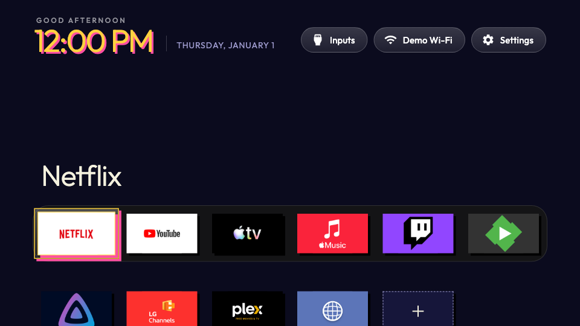
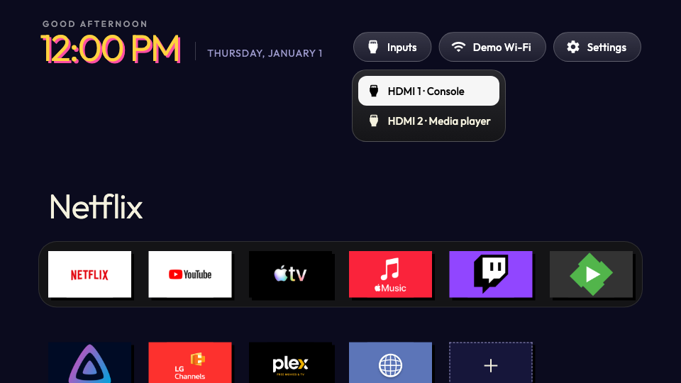
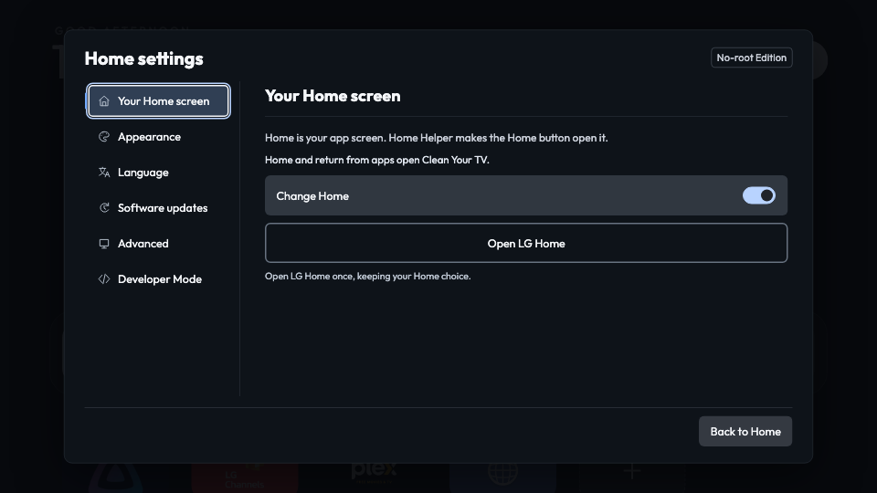

# Retro — a Clean Your TV theme

A neon pixel-inspired theme for [Clean Your TV](https://github.com/Razdva122/clean-your-tv-lg-webos) on LG webOS: square cards, hard shadows and a night-blue grid, with a yellow `#ffd23f` accent.



## Preview

| Home | Inputs | Settings |
|:---:|:---:|:---:|
|  |  |  |

> Screenshots come from the Clean Your TV author toolkit's browser renderer (960×540, no-root edition, en-US), not from a physical TV. See [`screenshots/retro/provenance.json`](screenshots/retro/provenance.json). The theme is suspended on the Settings screen by design.

## Details

| | |
|---|---|
| Theme ID | `github:xandymelo/clean-your-tv-lg-retro-theme:retro` |
| Version | 1.0.0 |
| Theme API | 1 |
| Layout | `dock-grid`, 6 columns, focus scale 1.1 |
| Defaults | accent `#ffd23f`, dim 0.2, no wallpaper |
| License | MIT |

## Repository layout

```
cytv-themes.json                  # theme index for this repository
themes/retro/                     # sources: theme.json, theme.css, preview, license, credits
distributions/retro/1.0.0/        # built distribution (cytv-theme.json + hashed assets)
screenshots/retro/                # rendered previews + provenance
```

The `cytv-themes.json` index points to `distributions/retro/1.0.0/cytv-theme.json` (sha256 `e03a9455…62f2c6`).

## Credits

CSS is original work by [xandymelo](https://github.com/xandymelo). The planned [Press Start 2P](https://fonts.google.com/specimen/Press+Start+2P) font (SIL OFL 1.1) is **not** bundled, because Theme API 1 doesn't accept local fonts or `@font-face`. See [`themes/retro/CREDITS.txt`](themes/retro/CREDITS.txt).

## License

[MIT](themes/retro/LICENSE.txt)
